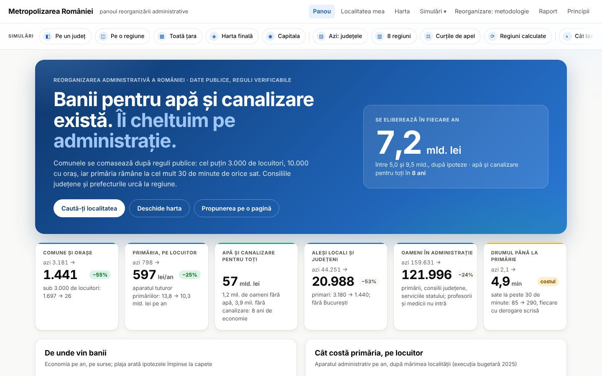
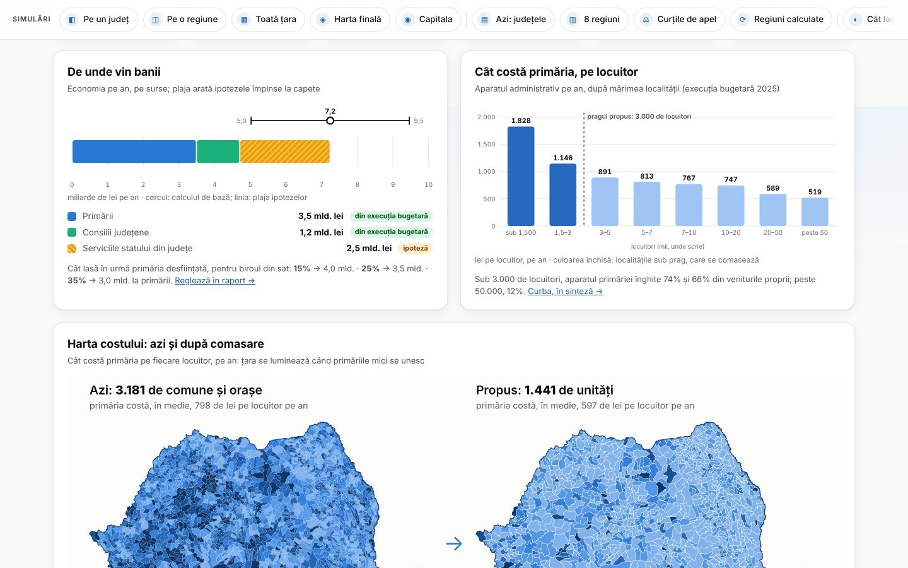
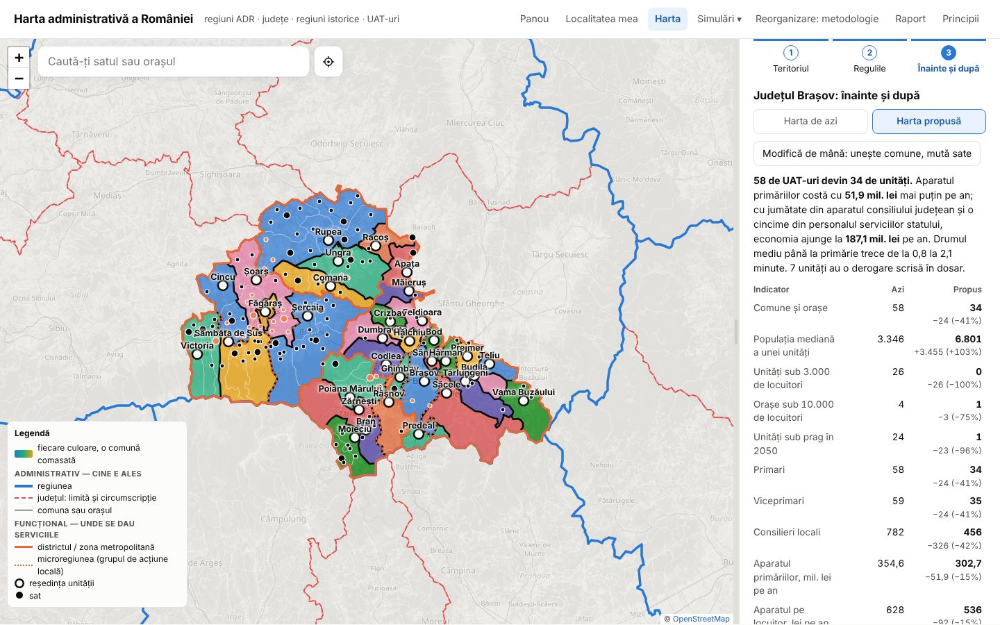
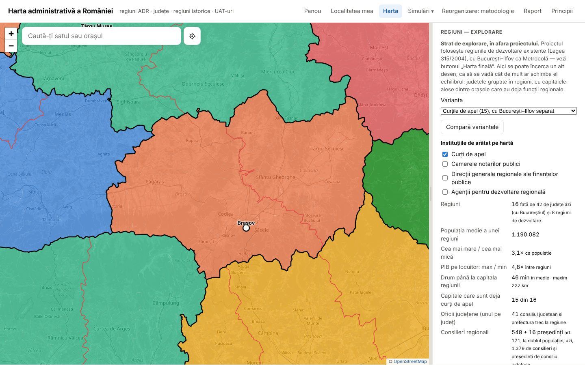
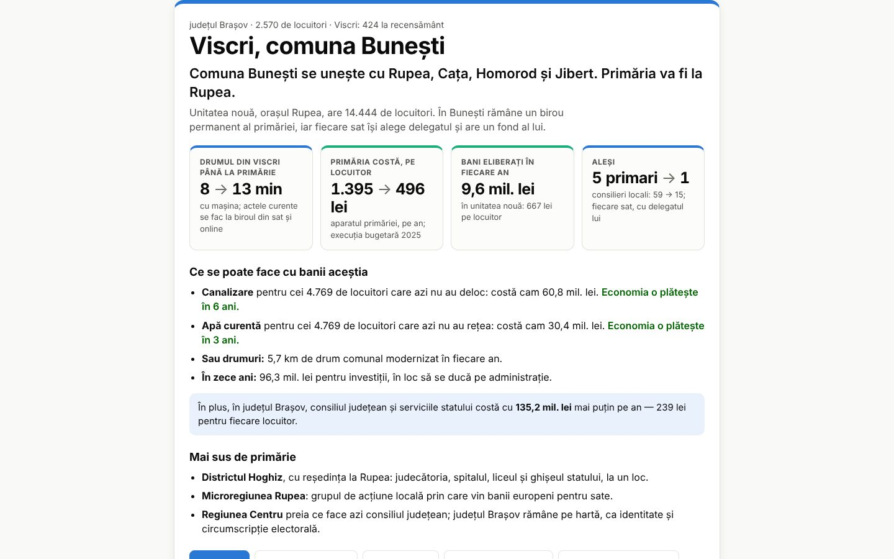

# Metropolizarea României

Hartă interactivă și raport pentru o propunere de reformă administrativ-teritorială: 8 regiuni de dezvoltare, județe ca limite și circumscripții, zone metropolitane și districte (circumscripțiile judecătoriilor), comune comasate.

**Site: [mihaiandreicut.github.io/metropolizarea-romaniei](https://mihaiandreicut.github.io/metropolizarea-romaniei/)** · [Panoul](https://mihaiandreicut.github.io/metropolizarea-romaniei/) · [Harta](https://mihaiandreicut.github.io/metropolizarea-romaniei/harta.html) · [Simulările](https://mihaiandreicut.github.io/metropolizarea-romaniei/simulari.html) · [Localitatea mea](https://mihaiandreicut.github.io/metropolizarea-romaniei/localitatea.html) · [Raportul](https://mihaiandreicut.github.io/metropolizarea-romaniei/raport.html) · [Sinteza](https://mihaiandreicut.github.io/metropolizarea-romaniei/sinteza.html)

| | |
|---|---|
| **3.181 → 1.441** comune și orașe | **7,2 mld. lei** pe an eliberați din administrație (între 5,0 și 9,5, după ipoteze) |
| **798 → 597 lei** costul primăriei pe locuitor | **57 mld. lei** apă și canalizare pentru toți: 8 ani de economie |
| **44.251 → 20.988** aleși locali și județeni | **2,1 → 4,9 min** drumul mediu până la primărie (290 de sate la peste 30 de minute) |

## Cum arată

| Simularea pe un județ (Brașov), pas cu pas | Regiunile: cele 15 curți de apel, cu București–Ilfov separat |
|---|---|
|  |  |

| Localitatea mea: fișa satului Viscri | Pe telefon |
|---|---|
|  |  |

Cifrele de mai sus vin din `date/panou.json` (`node unelte/panou.js`); capturile sunt din 18 noiembrie 2026.

## Ce e în proiect

Pagini:

- `index.html` — panoul de pe prima pagină: butoanele cu toate simulările, cifrele de bază, de unde vin banii, curba costului pe locuitor, harta costului, regiunile, variantele de regiuni și tabelul județelor (din `date/panou.json`); legăturile vechi `index.html#judet=…`, `#tara`, `#regiuni=…` duc la `harta.html`
- `simulari.html` — toate simulările, fiecare cu legătura ei directă pe hartă
- `localitatea.html` — „Localitatea mea”: cauți un sat, o comună sau un oraș (sau lași pagina să te găsească) și vezi pe loc cu cine se unește, drumul până la primărie, costul primăriei, banii eliberați și ce se poate face cu ei; cu imagine de distribuit
- `harta.html` — harta: simularea pas cu pas pe toată țara, pe o regiune sau pe un județ (teritoriul, regulile, raportul înainte și după, cu țara desfăcută pe regiuni și regiunea pe județe; legături directe `harta.html#tara`, `#regiune=N`, `#judet=COD`), plus explorarea liberă (regiuni, districte, comune comasate, indicatori pe UAT)
- `raport.html` — raportul cu cifre pe județe, costuri și economii
- `sinteza.html` — sinteza și regulile de comasare
- `principii.html` — principiile (administrativ vs. funcțional)
- `metodologie.html` — metoda și sursele

Site static, fără build: se deschide prin orice server HTTP (`python -m http.server`) sau direct prin GitHub Pages. Salvarea alegerilor de pe hartă (`date/corectii-districte.json`) cere `python unelte/server.py 8781`.

Scripturile de prelucrare a datelor sunt în `unelte/`. Populația de referință (rezidenții estimați pe UAT la 1 ianuarie, ultimul an publicat de INS: recensământul 2021, cu evoluția după domiciliu — plafonată la ±15% în afara zonelor periurbane, ca înscrierile în masă la domiciliu să nu treacă drept locuitori — adus la populația rezidentă pe județe) se actualizează cu `python unelte/populatie.py`; cifrele citate în sinteză se refac cu `node unelte/cifre.js`, fișele din „Localitatea mea” (`date/fise-localitati.json`) cu `node unelte/fise-localitati.js`, datele panoului (`date/panou.json`) cu `node unelte/panou.js`, harta costului de pe panou (`img/harta-cost.jpg`, cere Playwright) cu `node unelte/harta-cost.js`, iar sensibilitatea la ponderile scorului de centralitate cu `node unelte/ponderi-centralitate.js` — de rulat după orice schimbare de reguli sau de date. Datele vin din surse publice: INS TEMPO, data.gov.ro, geo-spatial.org, OpenStreetMap, Wikipedia (CC BY-SA 3.0) și execuția bugetară a UAT-urilor.
